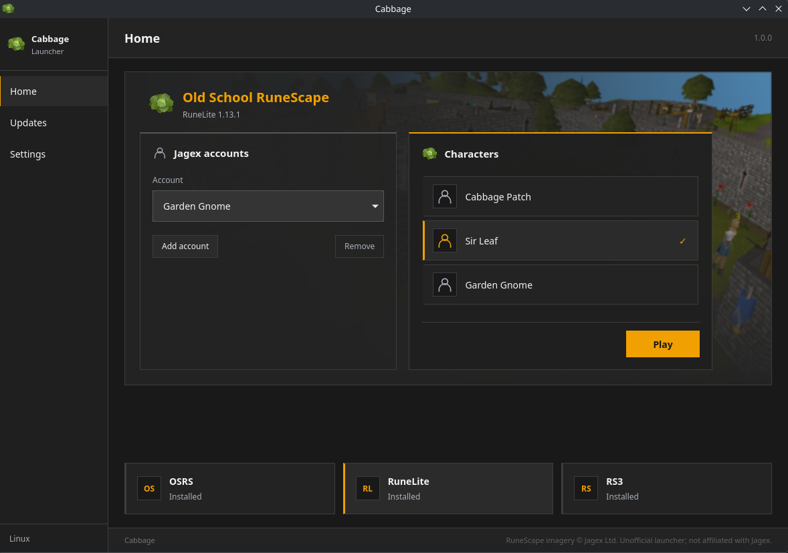

# Cabbage

An unofficial launcher for Old School RuneScape and RuneScape on Windows and Linux.

Sign in with your Jagex account, choose a character and client, and press **Play**. Cabbage downloads the client for you and remembers your accounts for next time.

[Download stable Cabbage](https://github.com/birdturtle/Cabbage/releases/latest) · [Developer-plugin beta 1.2.0-beta.2](https://github.com/birdturtle/Cabbage/releases/tag/v1.2.0-beta.2)

VirusTotal reports for **1.1.0**: [Windows EXE](https://www.virustotal.com/gui/file/c5656ac320e665b13f04fe48331218ba195dab7804ccaddba93c106d5269f884) · [Linux AppImage](https://www.virustotal.com/gui/file/33d510ccc493ef5b6c91520de57177ee0e10c0504dd0e49f0a256622c4874e20)



## Clients

| Client | Windows | Linux |
| --- | --- | --- |
| RuneLite | Native | Native |
| Official Old School RuneScape | Native | Requires Wine |
| RuneScape | Native | Native |

## Dependencies

### Windows

- [Microsoft Edge WebView2 Runtime](https://developer.microsoft.com/en-us/microsoft-edge/webview2/#download-section) for the launcher.
- [Microsoft Visual C++ Redistributable x64](https://learn.microsoft.com/en-us/cpp/windows/latest-supported-vc-redist) for the official Old School client.

Cabbage offers to install missing Windows runtimes with your approval.

### Linux

- glibc 2.35 or newer.
- [FUSE support](https://docs.appimage.org/user-guide/troubleshooting/fuse.html) to run the AppImage.
- A running, unlocked desktop keyring with Secret Service support, such as GNOME Keyring or KWallet with Secret Service enabled.
- XWayland when using a Wayland desktop.
- Wine for the official Old School client.
- SDL2, EGL and OpenGL libraries for RuneScape.

**Install requirements** opens a terminal to install missing game dependencies. Supported systems: Arch, Debian 12/13, Ubuntu 22.04/24.04, Fedora 43/44, openSUSE Tumbleweed and Leap 16.0. Linux dependency installation requires sudo. On Arch it also updates system packages.

Cabbage downloads RuneLite's Java runtime and RuneScape's OpenSSL compatibility libraries automatically.

## Install

Download the file for your system from the [latest release](https://github.com/birdturtle/Cabbage/releases/latest). Both downloads are for x64 systems.

### Windows

1. Open `Cabbage-Windows-x64-1.1.0.exe`.
2. Choose **Install Cabbage** to add it to your Start Menu, or **Keep portable** to run it from the downloaded file.

Installation does not require administrator access.

### Linux

Make the AppImage executable and open it:

```sh
chmod +x Cabbage-Linux-x64-1.1.0.AppImage
./Cabbage-Linux-x64-1.1.0.AppImage
```

Choose **Install Cabbage** to add it to your application menu, or **Keep portable**. Installation does not require sudo.

## Play

1. Select **Add account** and sign in with your Jagex account.
2. Choose your account and character.
3. Select **OSRS**, **RuneLite** or **RS3** from the client cards at the bottom.
4. Press **Play**. The first launch downloads and installs the selected client.

You can add multiple accounts and switch between them. Use **Remove** to remove the selected account from Cabbage.

Right-click a client card to **Repair** or **Uninstall** that client.

## Jagex account security

- Sign-in happens on Jagex's website inside the login window. Cabbage does not read or store your Jagex password or two-factor authentication codes.
- Cabbage receives login tokens from Jagex to load your characters, launch games and renew your login.
- Saved account sessions are encrypted on your computer. The encryption key is stored in Windows Credential Manager or your Linux desktop keyring. Tokens are not saved as plain text.
- Cabbage has no account server. Your login tokens are not sent to the developer.
- **Remove** deletes that account's saved session from Cabbage. It does not delete your Jagex account or revoke sessions through Jagex.

We recommend enabling [two-factor authentication with an authenticator app](https://support.runescape.com/hc/en-gb/articles/34154914236817) on your Jagex account, whichever launcher you use.

The [authentication](src-tauri/src/auth.rs) and [account storage](src-tauri/src/storage.rs) code is public.

## Settings

- Keep Cabbage open, hide it to the system tray, or close it after Play.
- Prefer your dedicated GPU; useful for those with integrated graphics and discrete graphics.
- Check for launcher updates on startup.
- Include beta updates if you want to try prereleases.
- View and copy game logs under **Advanced**, or open their folder.

Closing the window hides Cabbage to the tray. Use the tray menu to restore the window or exit. Exiting Cabbage leaves running games open.

## Updates

Open **Updates**, select **Check for updates**, then **Install update and restart** when a new version is available.

Updates work with installed and portable copies. Your accounts, settings and downloaded clients are kept, and running games stay open.

## Data locations

Cabbage stores saved data in these folders, including when you choose **Keep portable**:

| Files | Windows | Linux |
| --- | --- | --- |
| Accounts and settings | `%APPDATA%\com.birdturtle.cabbage` | `~/.config/com.birdturtle.cabbage` |
| Downloaded clients and app data | `%APPDATA%\com.birdturtle.cabbage` | `~/.local/share/com.birdturtle.cabbage` |
| Installed launcher | `%LOCALAPPDATA%\cabbage\launcher` | `~/.local/share/cabbage/launcher` |

Linux paths follow `XDG_CONFIG_HOME` and `XDG_DATA_HOME` if you have changed those locations. Portable copies keep the launcher file where you put it.

## Uninstall

Use the installation section in **Settings** to uninstall Cabbage. On Windows, you can also use **Installed Apps**.

Uninstalling the launcher keeps saved accounts, settings and downloaded games. Uninstall individual clients from their right-click menus before removing the launcher if you want those removed too.

## Project

[Report a bug](https://github.com/birdturtle/Cabbage/issues) · [Build from source](docs/development.md)

BSD 2-Clause. See [LICENSE](LICENSE) and [third-party notices](THIRD-PARTY-NOTICES.md). Based on HapticScape's launcher.

Unofficial software. Not affiliated with Jagex or RuneLite.

## Local developer plugins

For private RuneLite plugin testing, **Settings → Advanced → Developer plugins** lets you select plugin JARs and opt into a separate developer launch. Normal RuneLite remains available by switching the option off. Local plugins are unreviewed and must be trusted. See [setup, packaging and compatibility notes](docs/developer-plugins.md).
